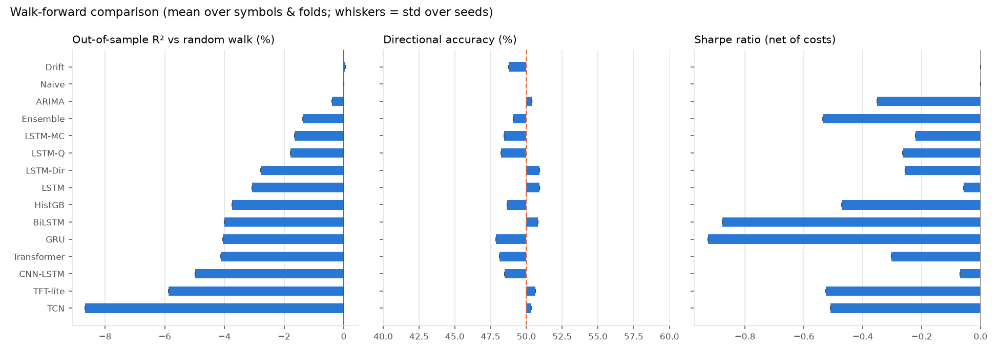
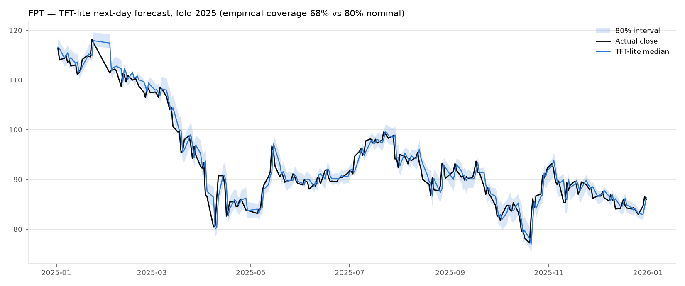
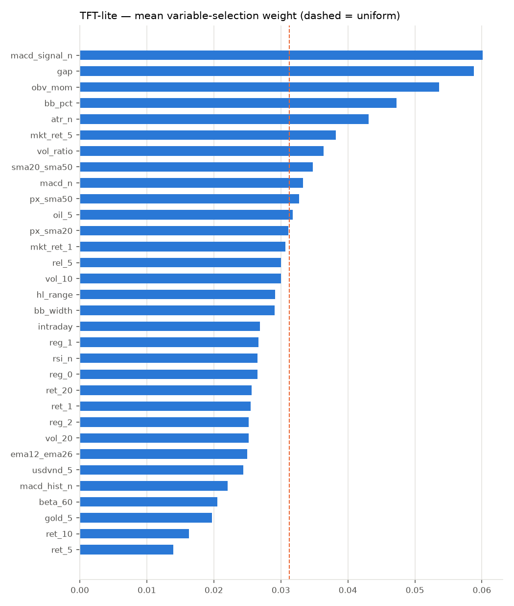
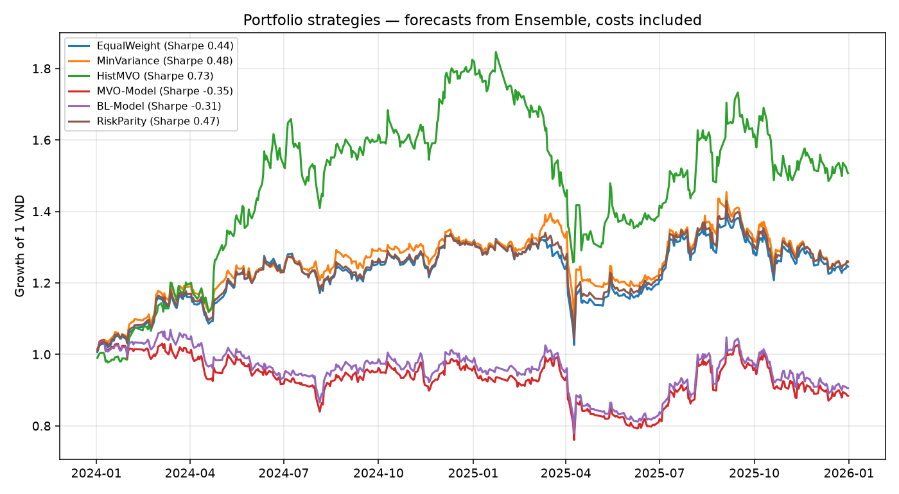

# Experiment report

Symbols: FPT, HPG, VCB  
Folds: 2024, 2025  
Seeds: [42]

## 1. Model comparison (walk-forward, net of costs)

Mean over symbols and folds; ± is the std across seeds. OOS R² is relative to the random-walk (Naive) forecast: **positive means the model beats Naive on squared return error**.

| model | runs | MAPE % (price) | OOS R² % | DA % | Sharpe (binary) | Sharpe (sized) | Return % (binary) |
|---|---|---|---|---|---|---|---|
| Drift | 6 | 1.07 ± 0.00 | 0.05 ± 0.00 | 48.8 ± 0.0 | 0.00 ± 0.00 | 0.00 ± 0.00 | 0.0 ± 0.0 |
| Naive | 6 | 1.06 ± 0.00 | 0.00 ± 0.00 | — | 0.00 ± 0.00 | 0.00 ± 0.00 | 0.0 ± 0.0 |
| ARIMA | 6 | 1.06 ± 0.00 | -0.39 ± 0.00 | 50.4 ± 0.0 | -0.35 ± 0.00 | -0.70 ± 0.00 | 1.8 ± 0.0 |
| Ensemble | 6 | 1.07 ± 0.00 | -1.38 ± 0.00 | 49.1 ± 0.0 | -0.53 ± 0.00 | -2.90 ± 0.00 | -1.2 ± 0.0 |
| LSTM-MC | 6 | 1.08 ± 0.00 | -1.65 ± 0.00 | 48.4 ± 0.0 | -0.22 ± 0.00 | -1.66 ± 0.00 | 2.0 ± 0.0 |
| LSTM-Q | 6 | 1.08 ± 0.00 | -1.79 ± 0.00 | 48.2 ± 0.0 | -0.26 ± 0.00 | -0.16 ± 0.00 | 2.1 ± 0.0 |
| LSTM-Dir | 6 | 1.08 ± 0.00 | -2.78 ± 0.00 | 50.9 ± 0.0 | -0.25 ± 0.00 | -0.29 ± 0.00 | -2.1 ± 0.0 |
| LSTM | 6 | 1.08 ± 0.00 | -3.07 ± 0.00 | 50.9 ± 0.0 | -0.06 ± 0.00 | -0.56 ± 0.00 | 1.0 ± 0.0 |
| HistGB | 6 | 1.09 ± 0.00 | -3.74 ± 0.00 | 48.6 ± 0.0 | -0.47 ± 0.00 | -1.57 ± 0.00 | 3.0 ± 0.0 |
| BiLSTM | 6 | 1.08 ± 0.00 | -4.00 ± 0.00 | 50.8 ± 0.0 | -0.88 ± 0.00 | -1.12 ± 0.00 | 2.1 ± 0.0 |
| GRU | 6 | 1.09 ± 0.00 | -4.06 ± 0.00 | 47.9 ± 0.0 | -0.93 ± 0.00 | -1.29 ± 0.00 | -1.2 ± 0.0 |
| Transformer | 6 | 1.10 ± 0.00 | -4.12 ± 0.00 | 48.1 ± 0.0 | -0.30 ± 0.00 | -1.06 ± 0.00 | -4.4 ± 0.0 |
| CNN-LSTM | 6 | 1.09 ± 0.00 | -4.98 ± 0.00 | 48.5 ± 0.0 | -0.07 ± 0.00 | -0.85 ± 0.00 | 1.1 ± 0.0 |
| TFT-lite | 6 | 1.11 ± 0.00 | -5.87 ± 0.00 | 50.6 ± 0.0 | -0.52 ± 0.00 | -1.05 ± 0.00 | -1.5 ± 0.0 |
| TCN | 6 | 1.13 ± 0.00 | -8.67 ± 0.00 | 50.4 ± 0.0 | -0.51 ± 0.00 | -0.63 ± 0.00 | -0.3 ± 0.0 |

Buy & hold over the same blocks: 15.0% mean return per fold.

## 2. Diebold-Mariano test vs Naive

Seed-bagged forecasts, squared return error, HLN-corrected. `better_sig` = number of symbols where the model is significantly better than Naive at 5% (one-sided).

| model | symbols | better_sig | worse_sig | mean_loss_diff | median_p_two_sided |
|---|---|---|---|---|---|
| BiLSTM | 3 | 0 | 2 | 8.447e-06 | 0.00804 |
| TFT-lite | 3 | 0 | 2 | 1.359e-05 | 0.008737 |
| TCN | 3 | 0 | 2 | 1.466e-05 | 0.02118 |
| GRU | 3 | 0 | 2 | 8.388e-06 | 0.0261 |
| Transformer | 3 | 0 | 2 | 8.284e-06 | 0.04121 |
| LSTM | 3 | 0 | 1 | 4.654e-06 | 0.06232 |
| CNN-LSTM | 3 | 0 | 1 | 1.142e-05 | 0.08837 |
| LSTM-MC | 3 | 0 | 1 | 3.537e-06 | 0.1234 |
| HistGB | 3 | 0 | 0 | 9.247e-06 | 0.1236 |
| LSTM-Dir | 3 | 0 | 1 | 6.758e-06 | 0.1629 |
| Ensemble | 3 | 0 | 1 | 2.185e-06 | 0.2956 |
| LSTM-Q | 3 | 0 | 0 | 4.156e-06 | 0.3186 |
| ARIMA | 3 | 0 | 0 | 9.348e-07 | 0.531 |
| Drift | 3 | 0 | 0 | 1.17e-07 | 0.9462 |

## 3. Directional accuracy by market regime

| model | DA calm | DA normal | DA turbulent |
|---|---|---|---|
| ARIMA | 0.4932 | 0.553 | 0.5042 |
| BiLSTM | 0.5027 | 0.5284 | 0.5161 |
| CNN-LSTM | 0.4755 | 0.5073 | 0.4856 |
| Drift | 0.5027 | 0.4354 | 0.4737 |
| Ensemble | 0.4936 | 0.4878 | 0.4561 |
| GRU | 0.4761 | 0.4838 | 0.4859 |
| HistGB | 0.488 | 0.4727 | 0.5255 |
| LSTM | 0.514 | 0.4819 | 0.4831 |
| LSTM-Dir | 0.5095 | 0.5419 | 0.4568 |
| LSTM-MC | 0.4989 | 0.4473 | 0.4696 |
| LSTM-Q | 0.4884 | 0.4718 | 0.4651 |
| Naive | — | — | — |
| TCN | 0.4953 | 0.5231 | 0.4978 |
| TFT-lite | 0.508 | 0.5215 | 0.5135 |
| Transformer | 0.4845 | 0.4884 | 0.4821 |

## 4. Probabilistic forecasts (80% interval)

| model | int_picp | int_mean_width | nominal | coverage_gap |
|---|---|---|---|---|
| LSTM-MC | 0.1489 | 0.00419 | 0.8 | -0.6511 |
| LSTM-Q | 0.8229 | 0.03575 | 0.8 | 0.02289 |
| TFT-lite | 0.7835 | 0.03381 | 0.8 | -0.0165 |

## 7. RL agent (fitted Q-iteration)

| symbol | binary_total_return | binary_bh_return | binary_sharpe | binary_max_drawdown |
|---|---|---|---|---|
| FPT | 0.1753 | 0.2914 | 0.6916 | -0.1502 |
| HPG | 0.09666 | 0.1176 | 0.1397 | -0.1995 |
| VCB | -0.0288 | 0.04108 | -0.2652 | -0.1819 |

## 8. Portfolio study (Ensemble)

| strategy | total_return | ann_return | ann_vol | sharpe | max_drawdown | avg_turnover |
|---|---|---|---|---|---|---|
| EqualWeight | 0.2454 | 0.1172 | 0.1948 | 0.4354 | -0.2331 | 0.01535 |
| MinVariance | 0.2609 | 0.1242 | 0.1895 | 0.4752 | -0.2192 | 0.04519 |
| HistMVO | 0.5072 | 0.2302 | 0.276 | 0.7256 | -0.3189 | 0.07546 |
| MVO-Model | -0.1163 | -0.06052 | 0.2322 | -0.347 | -0.2689 | 0.7091 |
| BL-Model | -0.09424 | -0.04876 | 0.2231 | -0.3144 | -0.2709 | 0.6008 |
| RiskParity | 0.2584 | 0.1231 | 0.1912 | 0.4675 | -0.2211 | 0.02147 |

